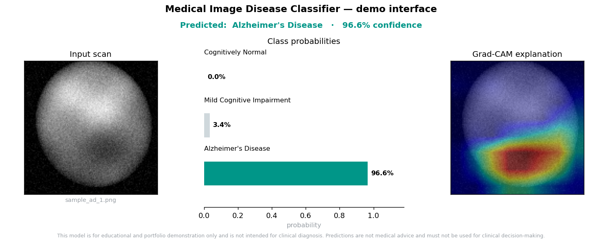
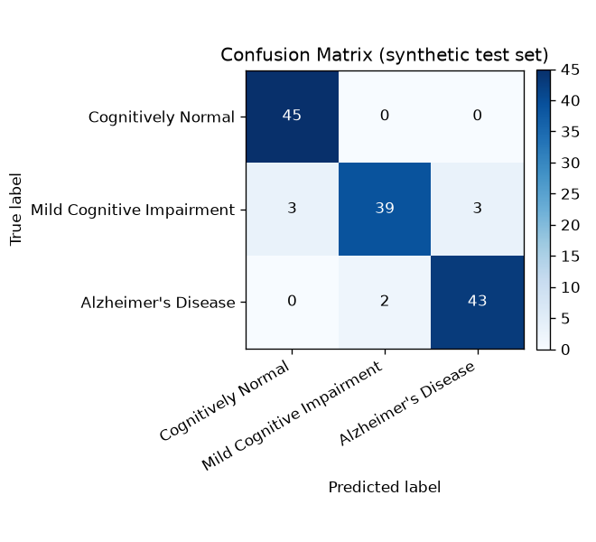

# Medical Image Disease Classifier API

A production-style medical image classification service that accepts a brain
scan image and returns a predicted disease class with calibrated-style
confidence scores over all classes. It is inspired by an Alzheimer's PET
classification research project and re-frames that work as a **deployable ML
system**: preprocessing, model serving, an HTTP API, containerization, tests,
CI, and explainability.

> **Disclaimer.** This project is for **educational and portfolio demonstration
> only**. The model is trained on a **synthetic** dataset, is **not clinically
> validated**, and must **not** be used for medical diagnosis or any clinical
> decision-making. Every prediction response repeats this disclaimer.

<p align="left">
  <a href="https://github.com/Rustam751/medical-image-classifier/actions/workflows/ci.yml"></a>
  
  
  
  
  
  
</p>



<p align="center"><em>The demo takes an image and returns the predicted class, a probability breakdown, and a Grad-CAM explanation of where the model looked. Output shown is from the committed model on a bundled sample.</em></p>

---

## Table of contents

- [What this project is](#what-this-project-is)
- [Why it matters](#why-it-matters)
- [System architecture](#system-architecture)
- [Tech stack](#tech-stack)
- [Model approach](#model-approach)
- [Dataset](#dataset)
- [Quickstart](#quickstart)
- [Demo interface](#demo-interface)
- [Using the API](#using-the-api)
- [Evaluation results](#evaluation-results)
- [Explainability (Grad-CAM)](#explainability-grad-cam)
- [Project structure](#project-structure)
- [Testing & CI](#testing--ci)
- [Limitations](#limitations)
- [Future work](#future-work)
- [What this project demonstrates](#what-this-project-demonstrates)

---

## What this project is

The original research project trained transfer-learning models (VGG16,
InceptionV3, ResNet50) to classify amyloid-PET brain scans from the
access-restricted **ADNI** dataset into cognitive-status categories. That work
stopped at the notebook stage.

**This project extends that workflow into a production-style ML service.**
Instead of stopping at model training, it focuses on the full deployment path:

```
Raw image → validation → preprocessing → model inference → structured response
          → API / demo UI / CLI → Docker → tests → documentation
```

The three classes are:

| Class | Meaning |
|-------|---------|
| `Cognitively Normal` | No cognitive impairment |
| `Mild Cognitive Impairment` | Intermediate stage |
| `Alzheimer's Disease` | Alzheimer's-stage impairment |

## Why it matters

Many ML portfolios stop at a `.ipynb` with a high accuracy number. Hiring teams
for ML/AI engineering roles look for the next step: **can you turn a model into a
service someone else can run?** This repository is built to answer that question.
It demonstrates model serialization, an inference API with input validation and
error handling, reproducible training, a Dockerized runtime, automated tests, CI,
and honest evaluation — the things that separate an ML *engineering* project from
an ML *notebook*.

## System architecture

```
        TRAINING (offline)                       INFERENCE (online)
 ┌──────────────┐  ┌────────────┐        ┌───────────┐  ┌───────────────┐
 │ dataset      │─▶│ preprocess │─▶ ... ─▶│ model.pt  │─▶│ FastAPI /      │
 │ (synthetic   │  │ transforms │        │ weights + │  │ Streamlit /CLI │
 │  or real)    │  └────────────┘        │ metadata  │  │  → JSON + PNG  │
 └──────────────┘        ▲               └───────────┘  └───────────────┘
                         │                     ▲
                         └───── same preprocessing path ─────┘
```

The same preprocessing function is used at train and serve time, and the
normalization statistics are stored **inside** the checkpoint, eliminating
training/serving skew. See [`docs/architecture.md`](docs/architecture.md) for
details.

## Tech stack

- **ML:** PyTorch (CPU), NumPy, scikit-learn (metrics), Matplotlib (plots)
- **Serving:** FastAPI + Uvicorn, Pydantic (typed request/response schemas)
- **Demo UI:** Streamlit
- **Packaging/DevOps:** Docker, docker-compose, GitHub Actions CI, Ruff, Pytest
- **Config:** YAML + environment-variable overrides

## Model approach

The model is a compact custom CNN (`SmallCNN`, ~98k parameters): four
`Conv → BatchNorm → ReLU → MaxPool` blocks, global average pooling, and a
dropout + linear classifier head.

**Why not VGG16/ResNet50 transfer learning here?** The original research used
ImageNet-pretrained backbones, which are the right choice for a GPU research
setting with real data. For a *deployable demo service* the priorities differ:

- **Small artifact** — the checkpoint is ~0.4 MB, so it ships in the repo and the
  API works immediately on clone with no weight download.
- **CPU-friendly** — inference is milliseconds on CPU; the container needs no GPU.
- **Self-contained** — no `torchvision`/ImageNet download at build time, keeping
  the Docker image lean and the build reproducible offline.

The architecture factory (`build_model`) leaves a clean seam for adding
transfer-learning backbones later without touching the training or serving code.

## Dataset

The real ADNI PET data is access-restricted and cannot be redistributed, so this
repository ships a **deterministic synthetic dataset generator**. It produces
grayscale brain-phantom images whose classes differ by an anterior–posterior
"uptake" contrast plus per-image noise, giving a **genuine but non-trivial**
learning signal.

**This is stated plainly:** the images are procedurally generated shapes, not
real scans, and the reported metrics demonstrate the *engineering pipeline*, not
clinical validity. The data is regenerated from a fixed seed, so results are
fully reproducible.

**Bring your own data.** The training pipeline reads a standard `ImageFolder`
layout. To train a real model, arrange images as below and point
`paths.synthetic_dir` at your directory — no code changes required:

```
<your_data>/
  train/{CN,MCI,AD}/*.png
  val/{CN,MCI,AD}/*.png
  test/{CN,MCI,AD}/*.png
```

## Quickstart

Requires Python 3.10+. These commands work identically on Linux, macOS, and
Windows (PowerShell or CMD) — no `PYTHONPATH` or `make` required.

```bash
# 1. Install dependencies (CPU PyTorch) and the package itself (editable)
pip install -r requirements-dev.txt --extra-index-url https://download.pytorch.org/whl/cpu
pip install -e .

# 2. Run the API — a trained checkpoint is already committed, so this works now
uvicorn medical_classifier.api.main:app --port 8000

# 3. Open the interactive docs
#    http://localhost:8000/docs
```

Then, in another terminal, send an image:

```bash
curl -X POST http://localhost:8000/predict -F "file=@samples/sample_ad_1.png"
```

To reproduce training (regenerates the synthetic data and writes `reports/`):

```bash
python -m medical_classifier.training.train
```

> **Tip.** `pip install -e .` installs `medical_classifier` into your
> environment, so `uvicorn`, `pytest`, and `python -m ...` all find it without
> setting `PYTHONPATH`. If you skip it, prefix commands with `PYTHONPATH=src`
> (Linux/macOS) or `$env:PYTHONPATH="src"` (PowerShell). The `make` targets set
> this for you.

### With Docker

```bash
docker compose up --build
# API on http://localhost:8000  (docs at /docs)
```

## Demo interface

A lightweight Streamlit app provides a visual interface: upload an image and see
the predicted class, a probability bar chart, and the Grad-CAM explanation (the
panel shown at the top of this README is this app's output). It loads the model
in-process, so the API does not need to be running.

```bash
python -m streamlit run app/streamlit_app.py   # opens http://localhost:8501
```

The static preview above can be regenerated from the committed model with:

```bash
python scripts/make_demo_preview.py
```

## Using the API

Predict on one of the bundled sample images:

```bash
curl -X POST http://localhost:8000/predict -F "file=@samples/sample_ad_1.png"
```

Example response:

```json
{
  "predicted_class": "Alzheimer's Disease",
  "confidence": 0.966,
  "class_probabilities": {
    "Cognitively Normal": 0.0005,
    "Mild Cognitive Impairment": 0.0339,
    "Alzheimer's Disease": 0.966
  },
  "input_metadata": {
    "filename": "sample_ad_1.png",
    "content_type": "image/png",
    "size_bytes": 11391
  },
  "disclaimer": "This model is for educational and portfolio demonstration only and is not intended for clinical diagnosis. Predictions are not medical advice and must not be used for clinical decision-making."
}
```

Endpoints: `GET /health`, `GET /model-info`, `POST /predict`, `POST /explain`.
Full reference in [`docs/api.md`](docs/api.md). The API validates content type
and size and returns clean error codes (`400/413/415/422/503`).

You can also predict from the command line without starting the server:

```bash
python scripts/predict_cli.py samples/sample_ad_1.png
```

## Evaluation results

Metrics below are produced by the committed model on the held-out **synthetic**
test split (135 images, balanced across 3 classes) and are reproducible via
`make train`. They are written to [`reports/`](reports/) as `metrics.json`,
`classification_report.txt`, and `confusion_matrix.png`.

| Class | Precision | Recall | F1 | Support |
|-------|:---------:|:------:|:--:|:-------:|
| Cognitively Normal | 0.94 | 1.00 | 0.97 | 45 |
| Mild Cognitive Impairment | 0.95 | 0.87 | 0.91 | 45 |
| Alzheimer's Disease | 0.93 | 0.96 | 0.95 | 45 |
| **Accuracy** | | | **0.94** | 135 |
| **Macro avg** | 0.94 | 0.94 | 0.94 | 135 |



Two things worth noting, because they show the result is *believable* rather than
inflated: the middle class (Mild Cognitive Impairment) is the hardest, and
misclassifications occur **only between adjacent classes** (CN↔MCI, MCI↔AD) —
never the extreme CN↔AD jump. That is exactly the error structure you would
expect from an ordinal disease-progression task.

> These numbers reflect a synthetic task and say nothing about real-world
> clinical performance.

## Explainability (Grad-CAM)

The `POST /explain` endpoint (and `--gradcam` CLI flag) returns a Grad-CAM
heatmap over the predicted class, so a reviewer can sanity-check *where* the
model is looking rather than trusting a bare score.


In this example the activation concentrates on the posterior region — the area
that carries the discriminative signal in the synthetic data — which is a useful
confirmation that the model learned the intended feature.

## Project structure

```
medical-image-classifier-api/
├── src/medical_classifier/
│   ├── config.py            # typed config (YAML + env overrides)
│   ├── constants.py         # class taxonomy, disclaimer
│   ├── preprocessing/       # shared image→tensor pipeline
│   ├── data/                # synthetic generator + ImageFolder dataset
│   ├── models/              # SmallCNN + build_model factory
│   ├── training/            # training loop + evaluation/reports
│   ├── inference/           # checkpoint I/O, Predictor, Grad-CAM
│   ├── api/                 # FastAPI app, schemas, model singleton
│   └── utils/               # logging, seeding
├── app/streamlit_app.py     # demo UI
├── scripts/                 # data generation, sample creation, CLI predict
├── tests/                   # pytest suite (preprocessing, model, predictor, API)
├── config/config.yaml       # central configuration
├── models/model.pt          # committed trained checkpoint (~0.4 MB)
├── reports/                 # metrics.json, confusion_matrix.png, classification_report.txt
├── samples/                 # ready-to-use sample images
├── Dockerfile, docker-compose.yml
├── .github/workflows/ci.yml # lint + test + docker build
└── docs/                    # architecture.md, api.md
```

## Testing & CI

```bash
make test    # pytest: 20 tests
make lint    # ruff
```

The suite covers preprocessing (shape, RGB handling, corrupt input, determinism),
the model (output shape, resolution-agnosticism, parameter budget, checkpoint
round-trip), the `Predictor` and Grad-CAM, and the full API (health, model-info,
valid prediction, and rejection of wrong content type / empty / corrupt uploads).
GitHub Actions runs lint + tests on Python 3.10 and 3.11 and builds the Docker
image on every push and PR.

## Limitations

- **Not a diagnostic tool.** The model is not clinically validated and must not
  inform medical decisions.
- **Synthetic data.** The demo model is trained on procedurally generated images.
  Metrics demonstrate the pipeline, not clinical accuracy, and will not transfer
  to real scans.
- **Domain shift.** Real medical models degrade across scanners, sites, and
  populations; this project does nothing to address that.
- **Confidence ≠ correctness.** Softmax scores are not calibrated probabilities
  and can be confidently wrong.
- **Small, balanced demo dataset.** Real clinical datasets are larger, noisier,
  and imbalanced; the pipeline supports imbalance handling but the demo does not
  exercise it heavily.

## Future work

- Train on a real, validated dataset (e.g. ADNI, with proper access) using the
  same `ImageFolder` interface.
- Add transfer-learning backbones (ResNet/EfficientNet) behind `build_model`.
- Confidence calibration (temperature scaling) and abstention thresholds.
- Experiment tracking (MLflow/W&B) and model/version registry.
- Cloud deployment, batch inference, authentication, rate limiting.
- Data-drift and model monitoring in production.

## What this project demonstrates

**Machine learning:** image classification, CNN design, a shared preprocessing
pipeline, train/val/test splits, early stopping, and honest evaluation
(accuracy, precision/recall/F1, confusion matrix, per-class analysis).

**ML engineering:** a clean, layered project structure; model serialization with
self-describing metadata; an inference API with input validation, error handling,
and logging; centralized configuration; Dockerization; a test suite; and CI —
with a deliberate separation between training and inference code.

**Communication:** a clear problem framing, documented architecture and API,
reproducible results, and an explicit, prominent statement of limitations and
non-clinical intent.

---

*Inspired by an Alzheimer's PET classification course project. Re-built as a
production-style ML service. For educational and portfolio use only — not a
medical device.*
